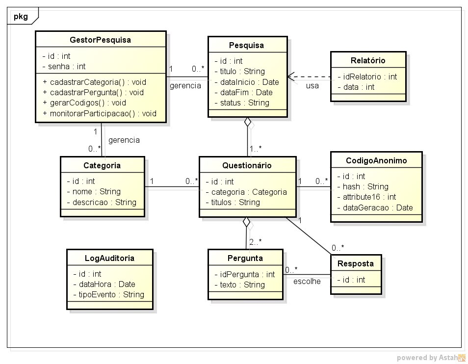

# Diagrama de Classes UML — Sistema de Pesquisas

**Disciplina:** Engenharia de Software II  
**Fase:** 2 — Issue #2  
**Artefato:** Diagrama de Classes UML

## Diagrama de Classes

## Classes representadas

O diagrama apresenta as classes **GestorPesquisa**, **Pesquisa**, **Relatório**, **Categoria**, **Questionário**, **CodigoAnonimo**, **LogAuditoria**, **Pergunta** e **Resposta**, bem como seus atributos, operações e relacionamentos conforme a modelagem produzida.

> **Observação:** Este documento registra o diagrama de classes já elaborado. O diagrama de sequência não está incluído nesta entrega parcial.
