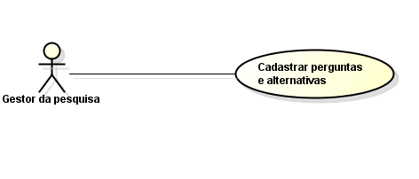
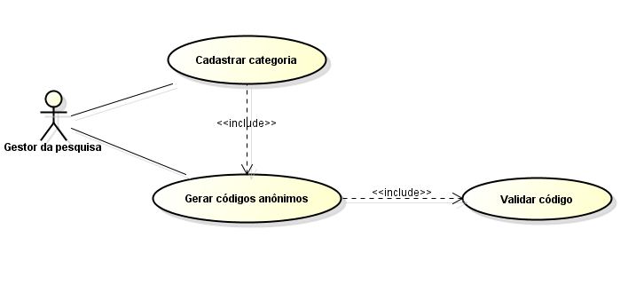
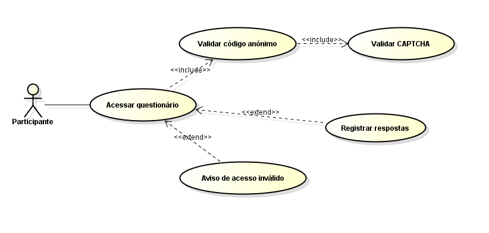
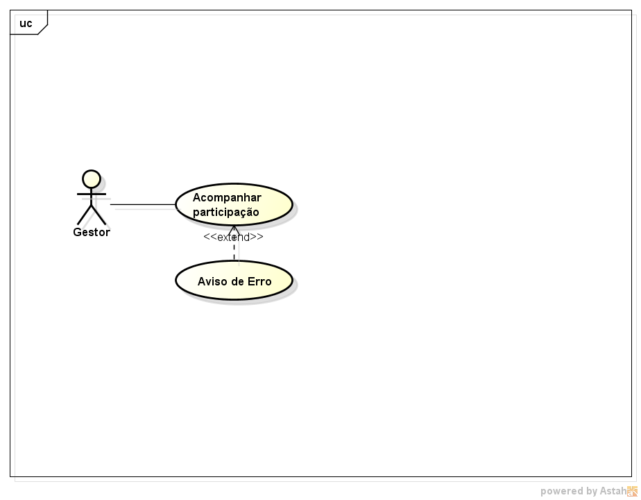
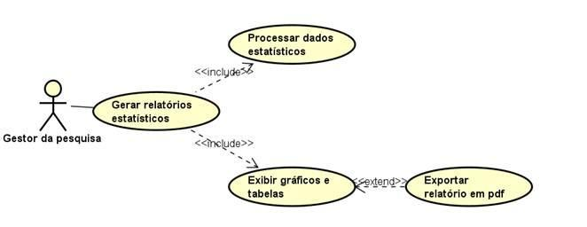
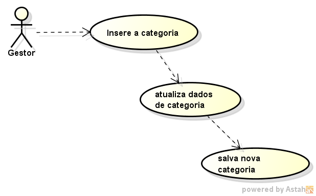

# Requisitos do Sistema

## Requisitos Funcionais# Engenharia de Software II — Levantamento de Requisitos e Casos de Uso

**Curso:** Análise e Desenvolvimento de Sistemas — FATEC  
**Projeto:** Sistema de Pesquisas Institucionais  
**Disciplina:** Engenharia de Software II  
**Documento de origem:** *EngSoft_estudodecaso.pdf* (trabalho de 08/09)

## Integrantes

- Geovanna Rocha Martins Ciriaco
- Giulia Komatsu Gentil
- Isabela Erminia Vieira Teixeira
- Poliana da Silva Benedito
- Rafaela da Silva Cavalheiro
- Yara Torres de Souza

## 1. Estudo de caso

O sistema a ser desenvolvido deverá permitir a **criação, aplicação e análise de pesquisas institucionais**, garantindo o anonimato dos participantes e a organização das respostas por categorias de respondentes.

## 2. Requisitos funcionais

Os requisitos abaixo foram organizados a partir da lista apresentada no estudo de caso. A numeração `RF` serve para facilitar a referência aos itens.

| Código | Requisito funcional |
|---|---|
| RF01 | Manter pesquisas. |
| RF02 | Manter categorias de participantes. |
| RF03 | Criar questionários por categoria. |
| RF04 | Cadastrar perguntas e alternativas. |
| RF05 | Gerar códigos anônimos de uso único. |
| RF06 | Aplicar questionários mediante código anônimo e CAPTCHA. |
| RF07 | Registrar respostas no banco de dados. |
| RF08 | Impedir a reutilização dos códigos anônimos. |
| RF09 | Monitorar a participação em tempo real. |
| RF10 | Gerar relatórios estatísticos. |
| RF11 | Permitir o acesso ao questionário. |
| RF12 | Registrar as respostas enviadas. |

> **Observação:** O trabalho original apresenta tanto “registrar respostas no banco de dados” quanto “registrar respostas”. Ambos foram preservados, embora descrevam funcionalidades relacionadas.

## 3. Requisitos não funcionais

| Área | Requisitos descritos no trabalho |
|---|---|
| Usabilidade | Interface web amigável; layout responsivo. |
| Segurança | Códigos anônimos protegidos por hash; validação de acesso; bloqueio de múltiplas respostas por código; CAPTCHA. |
| Desempenho | Capacidade de suportar múltiplos acessos simultâneos. |
| Portabilidade | Funcionamento em navegadores modernos. |
| Disponibilidade | Hospedagem web em nuvem, disponibilidade 24 horas por dia durante a pesquisa e suporte a cerca de 150 acessos simultâneos. |

## 4. Requisitos de segurança

O estudo de caso estabelece os seguintes cuidados:

- Utilizar HTTPS com SSL/TLS para proteger a comunicação entre navegador e servidor.
- Gerar códigos anônimos individuais, aleatórios e de uso único.
- Armazenar apenas o **hash** dos códigos de acesso, sem guardar seus valores originais no banco de dados.
- Invalidar cada código após o envio das respostas.
- Validar código anônimo e CAPTCHA antes da liberação dos questionários.
- Impedir respostas duplicadas e acessos indevidos automatizados.
- Fazer backups periódicos do banco de dados.
- Garantir integridade dos dados e dos arquivos armazenados.
- Manter softwares e plugins atualizados e realizar verificações contra malwares.
- Proteger domínio e registros DNS contra acesso não autorizado.
- Preservar o anonimato: não registrar IPs nem metadados que identifiquem os participantes.
- Exigir senhas fortes e autenticação segura para os gestores.

### 4.1. Auditoria

O sistema deverá registrar **data, hora e tipo do evento** (sucesso ou falha) quando códigos anônimos e CAPTCHAs forem validados ou recusados. Os registros de auditoria não deverão armazenar endereço IP, dados do dispositivo ou outras informações de identificação dos respondentes.

### 4.2. Autorização

- **Gestor da pesquisa:** utiliza login e senha para acessar cadastros, gerar códigos por categoria e visualizar os resultados em gráficos e tabelas.
- **Participante:** usa código anônimo de uso único e valida o CAPTCHA antes de responder às perguntas da categoria correspondente.
- **Sistema:** verifica os códigos, valida o CAPTCHA, direciona para o questionário e processa os dados.

### 4.3. Confiabilidade, disponibilidade e autenticidade

A comunicação será protegida com HTTPS. Os códigos serão gerados de forma criptograficamente segura, armazenados como hashes e invalidados após a conclusão da pesquisa. O estudo prevê hospedagem em nuvem, cerca de **150 acessos simultâneos**, disponibilidade contínua durante o período da pesquisa e backups periódicos. Os códigos serão vinculados à categoria do questionário, não ao nome, CPF ou e-mail do participante.

## 5. Atores

| Ator | Responsabilidades |
|---|---|
| **Gestor da pesquisa** | Criar e organizar pesquisas e categorias, cadastrar perguntas, gerar códigos, acompanhar participação e produzir relatórios. |
| **Participante** | Acessar o questionário com código e CAPTCHA e enviar respostas anônimas. |

O sistema realiza automaticamente atividades como a validação de códigos, o armazenamento de respostas e a invalidação de códigos utilizados.

## 6. Histórias e funcionalidades dos usuários

| Ator responsável | Funcionalidade | Resultado esperado |
|---|---|---|
| Gestor | Manter pesquisas | Informar título, período de duração e questões. |
| Gestor | Manter categorias | Organizar participantes e direcionar questionários por grupo. |
| Gestor | Criar questionários por categoria | Disponibilizar questionários acessíveis por código anônimo e CAPTCHA. |
| Gestor | Cadastrar perguntas e alternativas | Inserir perguntas e opções de resposta. |
| Gestor | Gerar códigos anônimos | Criar lotes de códigos de uso único, específicos para cada categoria. |
| Participante | Aplicar / responder questionários | Inserir código, resolver CAPTCHA e responder. |
| Sistema | Registrar respostas | Salvar os dados de maneira segura. |
| Sistema | Impedir reutilização de códigos | Invalidar o código após o envio. |
| Gestor | Monitorar participação | Verificar quantas pessoas acessaram e concluíram a pesquisa. |
| Gestor | Gerar relatórios | Consultar resultados em gráficos e tabelas. |
| Participante | Acessar questionário | Responder perguntas da sua categoria. |
| Participante | Solicitar novo código | Receber orientação para contatar o gestor, preservando o anonimato. |

## 7. Diagramas de casos de uso (UML)

As seis imagens abaixo foram **extraídas do PDF original**, sem redesenho, e devem ficar na pasta `diagramas/`, ao lado deste arquivo Markdown.

### 7.1. Cadastrar perguntas e alternativas

**Ator:** Gestor da pesquisa.

### 7.2. Gerar códigos anônimos de uso único

**Ator:** Gestor da pesquisa.

### 7.3. Acessar questionário

**Ator:** Participante.

### 7.4. Monitorar participação em tempo real

**Ator:** Gestor da pesquisa.

### 7.5. Gerar relatórios estatísticos

**Ator:** Gestor da pesquisa.

### 7.6. Manter categorias

**Ator:** Gestor da pesquisa.

## 8. Fluxos principais e alternativos

### 8.1. Cadastro de perguntas e alternativas

**Fluxo principal**

1. O gestor acessa a opção “Cadastrar Perguntas” no painel administrativo.
2. O sistema exibe o formulário de cadastro.
3. O gestor informa o enunciado e seleciona a categoria.
4. O gestor adiciona e preenche as alternativas.
5. O gestor confirma o cadastro.
6. O sistema valida os campos obrigatórios.
7. O sistema salva os dados no banco.
8. O sistema informa que a pergunta foi cadastrada e retorna ao menu inicial.

**Fluxo alternativo:** Se faltar enunciado ou alternativas, o sistema exibe uma mensagem de erro e solicita a correção dos campos.

### 8.2. Gerar códigos anônimos de uso único

**Fluxo principal**

1. O gestor acessa a geração de códigos.
2. O sistema solicita ou verifica a categoria vinculada.
3. Se necessário, é executado o cadastro da categoria.
4. O sistema gera um código aleatório e de uso único.
5. O sistema verifica a unicidade, o formato e os critérios de segurança.
6. O código válido é disponibilizado sem registrar a identidade do participante.

**Fluxos alternativos:**

- Se a categoria não existir, o sistema solicita seu cadastramento e retorna à geração do código.
- Se o código for inválido ou duplicado, ele é descartado e outro código é gerado e validado.

### 8.3. Acessar questionário

**Fluxo principal**

1. O participante acessa a página inicial.
2. O sistema solicita o código anônimo e apresenta o CAPTCHA.
3. O participante preenche o código e resolve o CAPTCHA.
4. O sistema valida o hash do código, verifica o CAPTCHA e identifica a categoria.
5. O sistema exibe as perguntas daquela categoria.
6. O participante responde e seleciona “Enviar Respostas”.
7. O sistema invalida o código utilizado, registra anonimamente as respostas e exibe uma confirmação.
8. O sistema retorna à tela inicial.

**Fluxos alternativos:**

- **Código inválido ou já utilizado:** exibir erro, registrar apenas data, hora e tipo de ocorrência e solicitar um novo código.
- **CAPTCHA inválido ou expirado:** exibir mensagem e gerar outro desafio.

### 8.4. Monitorar participação em tempo real

**Fluxo principal**

1. O gestor acessa “Acompanhar participação”.
2. O sistema consulta os registros de participação.
3. O sistema contabiliza os acessos e as pesquisas concluídas.
4. O sistema exibe os indicadores em tempo real.
5. O gestor acompanha as atualizações.

**Fluxo alternativo:** Caso a consulta ao banco falhe, mostrar mensagem de erro e permitir nova tentativa de atualização.

### 8.5. Gerar relatórios estatísticos

**Fluxo principal**

1. O gestor acessa “Relatórios Estatísticos”.
2. O sistema apresenta as pesquisas cadastradas.
3. O gestor escolhe uma pesquisa e solicita relatório por categoria.
4. O sistema busca as respostas anônimas e verifica se há dados suficientes.
5. O sistema processa estatísticas e exibe gráficos e tabelas.
6. O gestor escolhe “Exportar em PDF”.
7. O sistema disponibiliza o documento e confirma a exportação.

**Fluxos alternativos:**

- Se não houver dados, informar que o relatório não pode ser gerado.
- Se a conexão ao banco falhar, apresentar uma mensagem de indisponibilidade e retornar ao menu.

### 8.6. Manter categorias

**Fluxo principal**

1. O sistema apresenta as categorias cadastradas.
2. O gestor escolhe “Cadastrar Categoria”.
3. O sistema exibe o formulário.
4. O gestor informa os dados e confirma.
5. O sistema valida as informações.
6. O sistema salva a nova categoria e confirma o cadastramento.

**Fluxo alternativo:** Se os dados forem inválidos, o sistema solicita correções e realiza nova validação.

## 9. Considerações finais

O grupo elaborou a documentação inicial de um sistema de pesquisas institucionais, com foco na preservação do anonimato e na prevenção de respostas duplicadas. A combinação de **códigos anônimos de uso único** e **CAPTCHA** permite controlar o acesso sem identificar diretamente o participante.

O estudo também relacionou os requisitos e fluxos do sistema às possíveis tecnologias de implementação, como **PHP, MySQL, HTML e JavaScript**. Como próximos passos, o grupo apontou a melhoria das telas e o estudo de recursos de acessibilidade.

## 10. Referências

- FERNANDES, J. M.; MACHADO, R. J. *Requisitos em projetos de software e de sistemas de informação*. 1. ed. São Paulo: Novatec, 2017.
- GUEDES, Gilleanes T. A. *UML 2 — Uma abordagem prática*. 3. ed. São Paulo: Novatec, 2018.
- STALLINGS, William. *Segurança de Computadores: Princípios e Práticas*. 6. ed. São Paulo: Pearson Education do Brasil, 2018.

---

